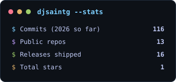
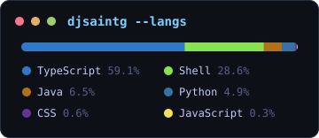

## 👋 Hey, I'm DJ Saint G

> 🎧 **Developer by craft, DJ by soul, saint by name.**

I build offline-first companion apps, interactive maps, game mods and Linux tools that just work: no accounts, no clutter, no signal required. Clean code with bold design, front-end engineering with audio-visual energy.

<p align="center">
  
  
  
  
</p>

---

### 📚 Library

#### 🗺️ Interactive Maps

**[🎮 A Highland Song — Interactive Map](https://github.com/djsaintg/A-Highland-Song-Interactive-Map)**
Unofficial fan tool for the game by inkle Ltd. Visualises all 38 peaks across 10 layers with blessings, directional routes, and a built-in BFS pathfinder.
*v1.3.0 — Stable*
`React` · `Vite` · `Tailwind CSS` · `MIT`
🌐 [Live Demo](https://djsaintg.github.io/A-Highland-Song-Interactive-Map/)

**[⛵ Spiritfarer — Everlight Atlas](https://github.com/djsaintg/Spiritfarer-Interactive-Map)**
Interactive map and quest log for Spiritfarer. All 38 locations at in-game coordinates, 183 quests with routed map pins, sea events, chests, and spoiler protection.
*v1.1.0 — Stable*
`React` · `TypeScript` · `Tailwind CSS` · `MIT`
🌐 [Live Demo](https://djsaintg.github.io/Spiritfarer-Interactive-Map/)

#### 📜 Game Companions

**[📜 RS3 Complete Guide](https://github.com/djsaintg/RS3-Companion-App)**
Offline-first companion app for RuneScape 3. 29 skill guides, live GE prices, multi-character profiles, and 332 quests, all in a single window.
*v1.1.0 — Stable*
`React` · `Vite` · `Tailwind CSS` · `MIT`
🌐 [Live Demo](https://djsaintg.github.io/RS3-Companion-App/)

**[🪄 Hogwarts Legacy — Guide of Requirement](https://github.com/djsaintg/Hogwarts-Legacy-Guide-of-Requirement)**
Offline-first companion for Hogwarts Legacy. Story-to-free-roam roadmap, 36-point talent planner, house-themed profiles, and Merlin Trial & Demiguise Moon trackers.
*v0.1.0 — Stable*
`React` · `TypeScript` · `Tailwind CSS` · `MIT`
🌐 [Live Demo](https://djsaintg.github.io/Hogwarts-Legacy-Guide-of-Requirement/)

#### ⚔️ Games

**[🔨 ForgeBound](https://github.com/djsaintg/ForgeBound)**
A single-player skilling RPG that compiles to one HTML file and runs 100% offline. Chop, mine, fish, smelt and smith across a procedural valley, with classic XP curves, banking and bartering. Built for dead zones.
*v0.5.0 — Gamma*
`TypeScript` · `React` · `Vite` · `MIT`
🌐 [Play in browser](https://djsaintg.github.io/ForgeBound/)

#### ⛏️ Minecraft Mods

Unofficial Fabric mods for Minecraft 26.3. Small, vanilla-friendly fixes for things that always bugged me.

| Mod | What it does | Version |
|---|---|---|
| **[🧲 Framed Hoppers](https://github.com/djsaintg/framed-hoppers)** | Put an item frame on a hopper and it only takes in the item shown. Sorting with no redstone. | *v1.0.1* |
| **[🧠 Crafting Memory](https://github.com/djsaintg/crafting-memory)** | Crafting tables remember what's in their grid, just like a chest. | *v1.0.0* |
| **[🌙 Night Shift](https://github.com/djsaintg/Night-Shift)** | Sleeping doesn't skip the night: furnaces smelt, crops grow, hoppers keep sorting. | *v1.0.0* |
| **[🏹 Scavenger](https://github.com/djsaintg/scavenger)** | Arrows that hit a block drop as items you can pick up, mob arrows included. | *v1.0.0* |

`Java 25` · `Fabric` · `Mixin` · `MIT`

#### 🧩 Hytale Mods

**[🧭 Objective Tracker](https://github.com/djsaintg/Objective-Tracker)**
A Zygor-style survival guide HUD for Hytale. 40 steps across 8 chapters, from your first sticks to an Adamantite Pickaxe, with live auto-completion and a waypoint arrow that points you at what you need next.
*v0.2.0 — Stable*
`Java` · `Hytale Plugin` · `Gradle` · `MIT`
📦 [Download](https://github.com/djsaintg/Objective-Tracker/releases/latest)

**[⛏️ Vein Mining](https://github.com/djsaintg/Vein-Mining)**
Mine one ore block and the whole connected vein comes with it, up to 64 blocks, nearest first. One vein, one metal, and every block still goes through the game's own mining rules.
*v0.1.0 — Stable*
`Java` · `Hytale Plugin` · `Gradle` · `MIT`
📦 [Download](https://github.com/djsaintg/Vein-Mining/releases/latest)

#### 🐧 Linux Tools

**[🎨 SteamGrid Filler](https://github.com/djsaintg/SteamGrid-Filler)**
Fills your non-Steam library with proper cover art from SteamGridDB. Careful name matching, dry-run mode, and it never overwrites art you've already set.
*v1.0.0 — Stable*
`Python 3` · `Standard library only` · `Linux` · `MIT`

#### 🤝 Open Source Work

**[🍲 Mealient (fork)](https://github.com/djsaintg/Mealient)**
My fork of the Android client for the self-hosted recipe manager Mealie. Adds shopping-list support for Mealie v3's household endpoints, list rename/delete, one-time household invites, and an unsigned release build for self-builders.
`Kotlin` · `Jetpack Compose` · `Android`

---

### 🛠️ Tech Stack

```
React   ██████████░░  TypeScript
Vite    █████████░░░  Tailwind CSS
Java    █████████░░░  Fabric · Mixin
Kotlin  ████████░░░░  Jetpack Compose
Python  ████████░░░░  Shell Scripting
Docker  ███████░░░░░  Self-hosting on Linux
```

---

### 📊 GitHub Stats

<p align="center">
  
  
</p>

<p align="center"><sub>Generated daily by a GitHub Action in this repo, no third-party service.</sub></p>

---

### 🎯 Currently

- 🌱 13 public projects shipped and counting, plus a shelf of private apps for home
- ⛏️ Writing small, vanilla-friendly Fabric mods for Minecraft 26.3
- 🏠 Running my own home server: media, budgets and documents, all self-hosted
- 📱 Building offline-first Android apps in Kotlin and Compose
- 🐧 Making Linux gaming a little less grey
- 🎵 Always coding to a beat

---

## 💖 Support my Work!

[](https://buymeacoffee.com/djsaintg)

---

<p align="center">
  <i>"Code with rhythm. Ship with grace."</i>
</p>
